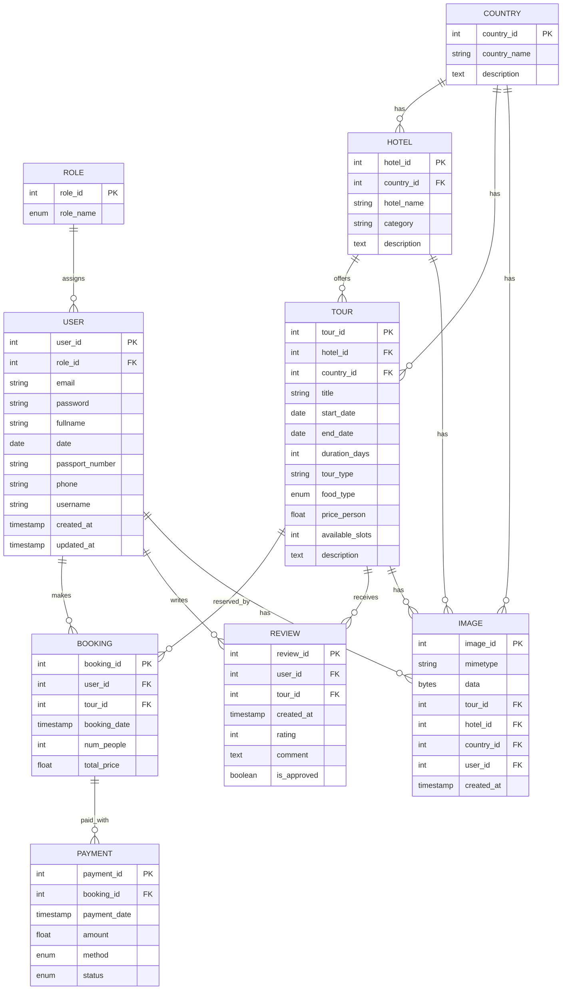

# Техническое задание

## Система управления туристического агенства

### Введение

**Общие сведения**  
Проект: Веб-сайт туристического агентства "Путешествия без границ"  
Цель: Создание современного, функционального сайта для продажи туров и туристических услуг

### Функционал

**Типы пользователей:**

- **Гость:**

  - Просмотр каталога туров
  - Поиск и фильтрация туров
  - Просмотр информации о странах и отелях
  - Чтение отзывов
  - Регистрация и вход в систему

- **Пользователь:**

  - Все права гостя
  - Бронирование туров
  - Оплата онлайн
  - Просмотр своих бронирований
  - Написание отзывов
  - Сохранение избранных туров
  - Редактирование личного профиля

- **Менеджер:**
- 
  - Добавление/редактирование туров
  - Управление описаниями отелей и стран
  - Модерация отзывов
  - Обновление фотогалерей

- **Админ:**
  - Полный доступ ко всем функциям
  - Управление пользователями и ролями
  - Настройка системы

**Интересные фичи:**

- Смена языков (ru, en, es) [next-intl]
- Изменение тем (темная, светлая) [next-themes]

## Структура и контент

### Управление турами и направлениями

Сначала администратор/менеджер добавляет новые туры в систему, вводя информацию о каждом туре, включая: название тура, страну назначения, отель, даты заезда/выезда, продолжительность, тип тура (пляжный, экскурсионный, горнолыжный и т.д.), категорию отеля, тип питания, цену, описание, включенные и невключенные услуги, а также количество доступных мест. Эта информация хранится в базе данных и обновляется по мере необходимости.

В случае бронирования тура, система регистрирует продажу в системе, что автоматически уменьшает количество доступных мест на забронированное.

Для каждого тура ведется учет в двух измерениях: количество мест и общая стоимость пакета. Система автоматически рассчитывает стоимость в зависимости от количества человек и выбранных опций.

Система позволяет генерировать отчеты о текущей доступности туров, загрузке направлений и других ключевых показателях.

### Управление продажами и бронированиями

При регистрации бронирования система автоматически обновляет количество доступных мест по туру. Каждая продажа фиксируется с указанием даты и времени бронирования.

### Взаимодействие с клиентами

Клиенты могут регистрироваться в системе, предоставляя свои персональные данные, включая: ФИО, дату рождения, контактный телефон и электронную почту.

Вход в систему происходит через код подтверждения по email.

Администратор может просматривать, редактировать и управлять профилями клиентов. В системе ведется полная история бронирований и взаимодействий каждого клиента.

### Бронирование туров

Клиенты могут выбирать туры для бронирования через интерфейс системы, указывая необходимые параметры: даты поездки, количество человек, тип номера и дополнительные услуги.

# Технологические требования

## Frontend

- Фреймворк: Next.js
- Язык: TypeScript
- State management: Zustand
- Маршрутизация: React Router
- REST API: Tanstack query, axios
- Вспомогательные библиотеки:
  - lucide icons
  - zod
  - framer-motion
  - react-hook-form

## Backend

- Nest.js
- ORM: Prisma

## Database

- PostgreSQL

# ER-диаграмма

